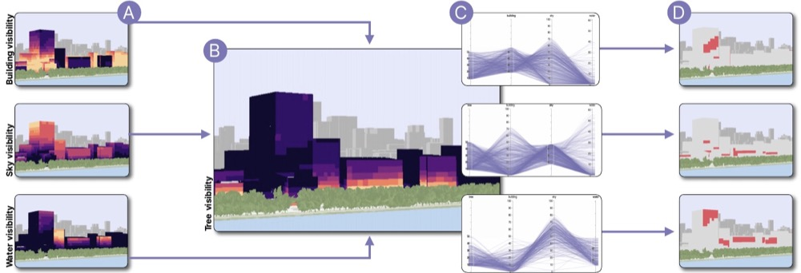
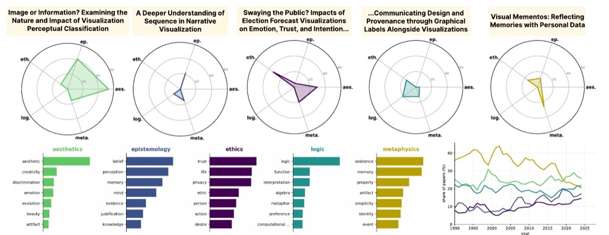
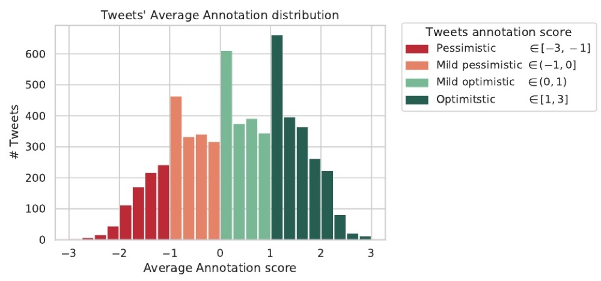
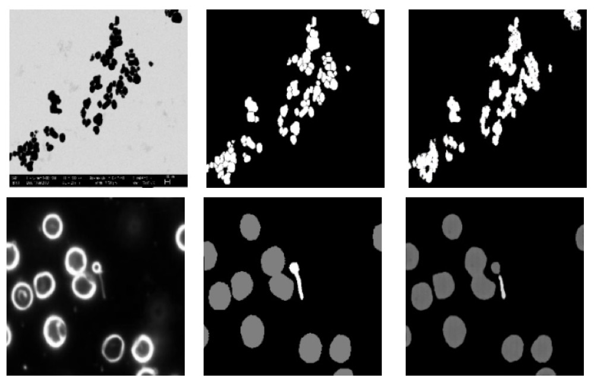
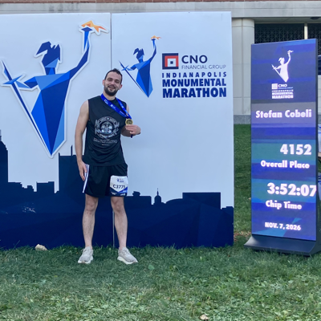
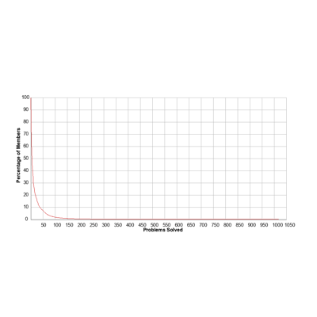
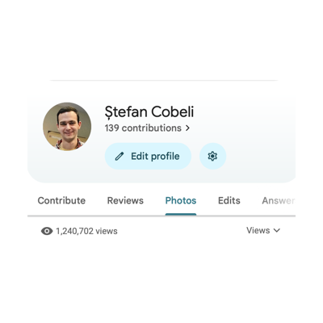
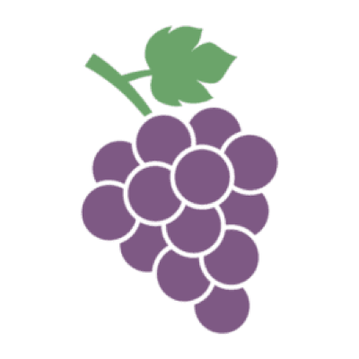
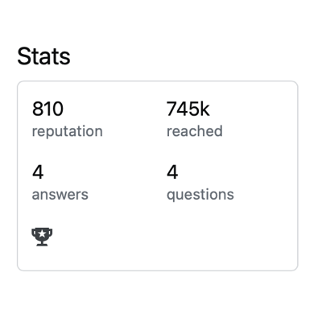

Stefan Cobeli is a PhD student in the [Electronic Visualization Laboratory (EVL)](https://www.evl.uic.edu/) at the University of Illinois Chicago ([UIC](https://uicflames.com/)). He is advised by Dr. [Fabio Miranda](https://fmiranda.me) and is part of the [urban lab](https://urbantk.org/team/). His research centers on data visualization, using machine learning to build visual tools for exploring and navigating city-wide datasets. He also serves as Academic & Research Technology Coordinator for UIC's [Communication Department](https://comm.uic.edu/profiles/stefan-cobeli/).

## Research

  <a class="tile" href="/research/neural-3d/">
    
    Neural Fields for 3D Cities
  </a>
  <a class="tile" href="/research/philosophy-vis/">
    
    Philosophy Lenses on VIS
  </a>
  <a class="tile" href="/research/optimism/">
    
    Optimism on Social Media
  </a>
  <a class="tile" href="/research/gan-segmentation/">
    
    Segmentation Domain Generation
  </a>

## Miscellanea

<!-- Thumbnails link to an image file, so the theme opens them in a popup; the title text (with its link) shows under the image -->

  <a class="tile" href="/assets/images/misc/full/marathon-results-map.png"
     title='Indianapolis Monumental Marathon 2026 · <a href="https://sites.chronotrack.com/event/93660/results/entry/79792547" target="_blank" rel="noopener">official results</a> &amp; <a href="https://track.rtrt.me/e/BM-MONUMENTAL-MARATHON-2026#/dash/RT67K8RV" target="_blank" rel="noopener">bib tracking</a>'>
    
    Marathon 2026
  </a>
  <a class="tile" href="https://projecteuler.net/profile/stefan.cobeli.png"
     title='Top 2% of problem solvers on Project Euler · <a href="https://projecteuler.net/profile/stefan.cobeli.png" target="_blank" rel="noopener">profile badge</a>'>
    
    Top 2% of problem solvers on Project Euler
  </a>
  <a class="tile" href="/assets/images/misc/full/google-maps.png" title="1.2M Google Maps contribution views">
    
    1.2M Google Maps contribution views
  </a>
  

    
    Certified in Montessori-based formation; taught pre-K to grad students
  

  <a class="tile" href="/assets/images/misc/full/stackoverflow-stats.png"
     title='700k users reached with Stack Overflow contributions · <a href="https://stackoverflow.com/users/7136493/Ștefan?tab=profile" target="_blank" rel="noopener">profile</a>'>
    
    700k users reached with Stack Overflow contributions
  </a>

