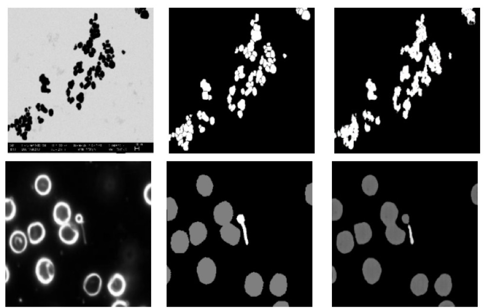

<a href="https://arxiv.org/abs/2107.02525">Paper</a> · <a href="/assets/papers/eeml-2021-poster.pdf">Poster</a> · <a href="/assets/papers/eeml-2021-slides.pdf">Slides</a> · <a href="https://youtu.be/wIFk63qSAF0">Video</a>

Ana-Cristina Rogoz, Radu Muntean, <strong>Stefan Cobeli</strong>

EEML 2021 · Best Poster Award

The work treats image segmentation as image-to-image translation: a GAN learns to turn a microscopy image into its segmentation mask, tested with conditional GANs and CycleGANs on particle and bacteria datasets.

[← Back](/)
