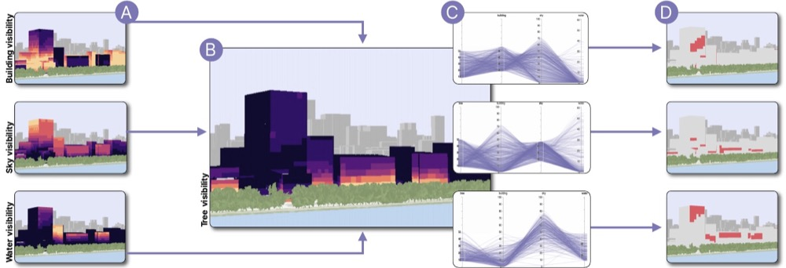

<a href="https://doi.org/10.1109/TVCG.2025.3635528">Paper</a> · <a href="https://urbantk.org/neural-3d">Code & data</a>

<strong>Stefan Cobeli</strong>, Kazi Shahrukh Omar, Rodrigo Valença, Nivan Ferreira, Fabio Miranda

IEEE TVCG · presented at IEEE VIS 2026

The work encodes what can be seen from every point of a 3D city into a compact neural field, making view analyses such as visibility and solar exposure fast enough for interactive exploration. Direct queries compute what is visible from a location; inverse queries find the locations that match a desired view.

[← Back](/)
