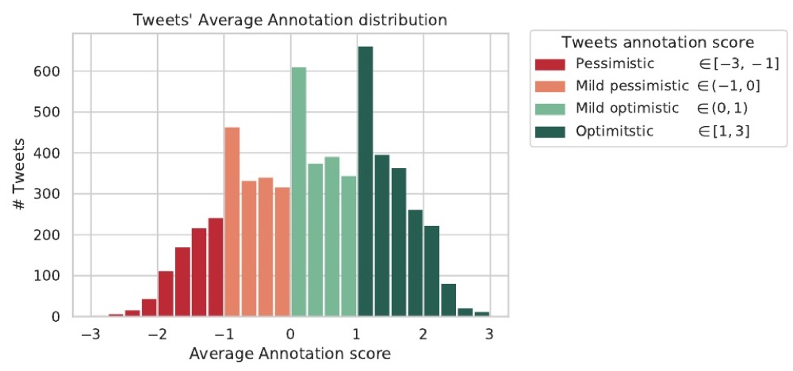

<a href="https://aclanthology.org/2022.lrec-1.218/">Paper</a> · <a href="/assets/papers/lrec-2022-poster.pdf">Poster</a> · <a href="/assets/papers/lrec-2022-slides.pdf">Slides</a>

<strong>Stefan Cobeli</strong>, Bogdan Iordache, Shweta Yadav, Cornelia Caragea, Liviu P. Dinu, Dragoș Iliescu

LREC 2022

The paper studies how optimism and pessimism show up in social media posts, beyond standard sentiment. A multi-task knowledge-distillation model, helped by sentiment analysis and hate-speech detection, improves optimism detection on the Optimism/Pessimism Twitter benchmark.

[← Back](/)
