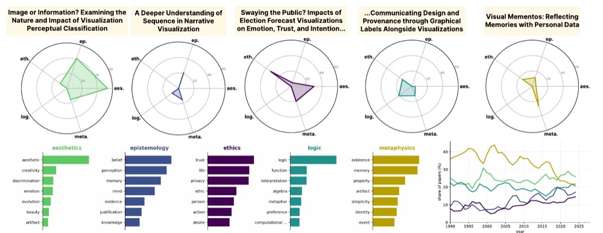

<a href="/assets/papers/philosophy-vis-paper-2026.pdf">Paper</a> · <a href="/assets/papers/philosophy-vis-poster-2026.pdf">Poster</a>

<strong>Stefan Cobeli</strong>, Gustavo Moreira

IEEE VIS 2026 · Poster

Visualization research makes philosophical commitments, mostly without naming them. The poster scores 4,645 IEEE VIS abstracts (1990–2024) against a lexicon of the five branches of philosophy: metaphysics leads, aesthetics follows, and over three decades the field drifts toward epistemology and ethics.

[← Back](/)
